# A modeling language for software people

The OpenFjord modeling language describes the things of a business, the
links between them, and the rules about them, in YAML files next to the code.
Its tool, `of-lang`, checks those files, derives the facts that nobody wrote
down, explains each one, and runs the model's tests.

<p align="center">
  
</p>

<p align="center">
  
</p>

Packages go into the language. An agent, an MCP (Model Context Protocol)
server, a coding factory, a knowledge base and a semantic layer use what it
knows.

> **Version 0.1.0.** Before version 1.0, the language can change in ways
> that break a package.

<!-- not on the site -->
The documentation is also a site: <https://lang.openfjord.io/>.
<!-- end -->

## Install

With [Homebrew](https://brew.sh):

```bash
brew install openfjord/tap/of-lang
```

Or download a binary for macOS or Linux from the
[releases](https://github.com/openfjord/of-lang/releases).

## Three small examples

Each example below is complete. It needs nothing from the other two.

Each example is a **package**: a folder with three files.

```
wrong-value/                 # the root of the package
  package.yaml               # the manifest: the name and the owner of the package
  defs/
    menu.of.yaml             # the definitions: what can exist, and the rules
  tests/
    examples/
      margherita.of.yaml     # the facts: what does exist, in one example
```

The manifest is four lines. Only the name is different in each example:

```yaml
# wrong-value/package.yaml
package: "@bistro/wrong-value"
version: 0.1.0
owner: kitchen
rdfNamespace: wrong-value
```

To try an example, make these files, or use the copies in
[`examples/quickstart`](examples/quickstart/). Run the commands in the
folder that holds the package.

### 1. Catch a wrong value

The definitions say what a dish is. A **kind** is a category of things, with
a definition in plain words. A **field** is a value that each thing of the
kind has. Here, each dish has a price, and the price is a number.

```yaml
# wrong-value/defs/menu.of.yaml
Dish:
  is: Kind
  definition: A food that the restaurant sells to guests.
  fields:
    price:
      type: number
      minimum: 0
```

A **fact** states one real thing. This file states one dish, the margherita,
and gives it a price that is not a number. The `import` block at the top
tells where the name `Dish` comes from. A file of facts ends with a
**test**, which tells what must follow from the facts. This one expects no
problem.

```yaml
# wrong-value/tests/examples/margherita.of.yaml
import:
  - from: file:../../defs/menu.of.yaml
    use: [Dish]

dish/margherita:
  is: Fact
  kind: Dish
  fields:
    price: twelve

oneDish:
  is: Test
  says: The margherita is a dish with a price.
  expect:
    rejected: []
```

The tool finds the wrong value, and tells the file, the line and the rule:

```console
$ of-lang test wrong-value
wrong-value/tests/examples/margherita.of.yaml:9:5: price: twelve is not of type number (FC4)
```

### 2. Let the tool conclude something

A guest with a nut allergy must know which dishes contain nuts. The kitchen
does not write that down for each dish. It writes down which ingredients
have nuts, and which dish uses which ingredient.

The definitions have three kinds. A **link** is a named relationship from
one kind to a different kind: a dish uses an ingredient. A **derivative**
is a rule that adds what follows. `match` finds each dish with one of its
ingredients, `filter` keeps the ingredients with nuts, and `derive` says
what follows: the dish is a dish with nuts.

```yaml
# with-nuts/defs/menu.of.yaml
Ingredient:
  is: Kind
  definition: A food that the kitchen buys and does not make.
  fields:
    hasNuts:
      type: boolean

Dish:
  is: Kind
  definition: A food that the restaurant sells to guests.

DishWithNuts:
  is: Kind
  extends: Dish
  definition: A dish that a guest with a nut allergy must not eat.

usesIngredient:
  is: Link
  from: Dish
  to: Ingredient
  reads: "{from} uses {to}"
  definition: The dish needs the ingredient.

dishWithNutsFromIngredient:
  is: Derivative
  says: A dish that uses an ingredient with nuts is a dish with nuts.
  match:
    - kind: { name: Dish, as: $dish }
    - kind: { name: Ingredient, as: $ingredient }
    - link: usesIngredient
      from: $dish
      to:   $ingredient
  filter:
    - node:  $ingredient
      field: hasNuts
      equals:
        value: true
  derive:
    - node: $dish
      becomes: DishWithNuts
```

The facts state two ingredients and two dishes. No fact says that a dish
has nuts.

```yaml
# with-nuts/tests/examples/pesto-pasta.of.yaml
import:
  - from: file:../../defs/menu.of.yaml
    use: [Ingredient, Dish, DishWithNuts, usesIngredient]

ingredient/pine_nuts:
  is: Fact
  kind: Ingredient
  fields:
    hasNuts: true

ingredient/tomatoes:
  is: Fact
  kind: Ingredient
  fields:
    hasNuts: false

dish/pesto_pasta:
  is: Fact
  kind: Dish
  links:
    usesIngredient: [ingredient/pine_nuts, ingredient/tomatoes]

dish/tomato_soup:
  is: Fact
  kind: Dish
  links:
    usesIngredient: ingredient/tomatoes

pestoPastaHasNuts:
  is: Test
  says: >
    The pesto pasta uses pine nuts, so it is a dish with nuts. The tomato
    soup is not.
  expect:
    derived:
      - node: dish/pesto_pasta
        becomes: DishWithNuts
    notDerived:
      - node: dish/tomato_soup
        becomes: DishWithNuts
```

`run` shows what follows from the facts. The tool concludes that the pesto
pasta is a dish with nuts, and names the derivative that says so:

```console
$ of-lang run with-nuts with-nuts/tests/examples/pesto-pasta.of.yaml
derived:
  dish/pesto_pasta is a DishWithNuts  (derivative dishWithNutsFromIngredient)
rejected:
  nothing
```

`test` makes sure that the conclusion stays correct when the definitions
change:

```console
$ of-lang test with-nuts
pass  test pestoPastaHasNuts  (with-nuts/tests/examples/pesto-pasta.of.yaml)
1 passed, 0 failed
```

### 3. Enforce a rule

A restaurant must not sell a dish for less than the dish costs to make. A
**constraint** is a rule that rejects facts. `match` finds each dish, and
`filter` keeps the dishes whose price is at most their cost. Each dish that
is left breaks the rule. `message` is what the tool tells about it.

```yaml
# below-cost/defs/menu.of.yaml
Dish:
  is: Kind
  definition: A food that the restaurant sells to guests.
  fields:
    price:
      type: number
    cost:
      type: number

dishSellsAboveCost:
  is: Constraint
  says: The price of a dish must be above what the dish costs to make.
  match:
    - kind: { name: Dish, as: $dish }
  filter:
    - node:  $dish
      field: price
      is at most:
        same as: { node: $dish, field: cost }
  message: "{$dish} sells for {$dish: price} and costs {$dish: cost}."
```

The facts state two dishes. The truffle pasta costs more than its price.

```yaml
# below-cost/tests/examples/two-dishes.of.yaml
import:
  - from: file:../../defs/menu.of.yaml
    use: [Dish, dishSellsAboveCost]

dish/margherita:
  is: Fact
  kind: Dish
  fields:
    price: 12
    cost: 4

dish/truffle_pasta:
  is: Fact
  kind: Dish
  fields:
    price: 18
    cost: 21

truffleDishLosesMoney:
  is: Test
  says: The truffle pasta sells below its cost, so the constraint rejects it.
  expect:
    rejected: [dishSellsAboveCost]
```

`run` rejects the truffle pasta, with the message of the constraint:

```console
$ of-lang run below-cost below-cost/tests/examples/two-dishes.of.yaml
derived:
  nothing
rejected:
  dishSellsAboveCost: dish/truffle_pasta sells for 18 and costs 21.
```

## Where to go next

- [The introduction](docs/introduction/README.md) builds the model of one
  kitchen in eight chapters. Each chapter is a question of the kitchen,
  such as "Which dishes contain nuts?", and ends with the answer of the
  tool.
- [The language by example](docs/by-example/README.md) has one short page
  for each thing in the language, with the text next to the code.
- [The language specification](language/README.md) tells what the language
  is, with its principles and its vocabulary.
  - [The cheat sheet](language/cheatsheet.md) has the whole language on one
    page.
  - [The reference](language/README.md#reference) has every rule.
- [The `of-lang` tool](cli/README.md) tells about each command and its
  output, and what is planned.
- [The full example package](examples/restaurant/) is the kitchen that the
  introduction builds. It depends on
  [a second package](examples/suppliers/), the restaurant's suppliers.
- [Why a model](docs/why.md) tells which problems a model solves, who it is
  for, and why this is a language of its own.
- [The design of the language](docs/design.md) tells what the language
  leaves out, the roads not taken, and the open questions.
- [The changelog](CHANGELOG.md) and [how to contribute](CONTRIBUTING.md).

## License

Licensed under the [Apache License 2.0](LICENSE).
