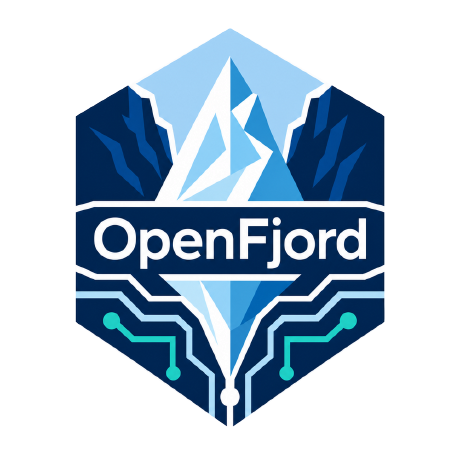

# A modeling language for software people

The OpenFjord modeling language describes the things of a business, the
links between them, and the rules about them, in YAML files next to the code.
Its tool, `of-lang`, checks those files, derives the facts that nobody wrote
down, explains each one, and runs the model's tests.

<p align="center">
  
</p>

> **Status: a draft, version 0.1.0.** The language may still change in ways
> that break a package.

## Install

With [Homebrew](https://brew.sh):

```bash
brew install openfjord/tap/of-lang
```

Or download a binary for macOS or Linux from the
[releases](https://github.com/openfjord/of-lang/releases).

Then try it on the example package, from a clone of this repository:

```bash
of-lang check examples/restaurant
```

```bash
of-lang test examples/restaurant
```

## Learn more

<!-- not on the site -->
The documentation is also a site, with all the pages below:
<https://lang.openfjord.io/>.
<!-- end -->

- [The introduction](docs/introduction/README.md): seven chapters that build
  the example package, a restaurant's kitchen, one idea at a time.
- [The language by example](docs/by-example/README.md): short pages that
  each show one thing, with the text next to the code.
- [The language specification](language/README.md): what the language is,
  its principles and its vocabulary.
  - [The cheat sheet](language/cheatsheet.md): the whole language on one page.
  - [The reference](language/README.md#reference): every rule.
- [The `of-lang` tool](cli/README.md): its commands and their output, and
  what is planned.
- [The example package](examples/restaurant/): a restaurant's kitchen
  stations, recipes, dishes, ingredients and allergens. It depends on
  [a second package](examples/suppliers/), the restaurant's suppliers.
- [The design of the language](docs/design.md): why ontologies are hard for
  software people, what the language leaves out, the roads not taken, and
  the open questions.
- [The changelog](CHANGELOG.md) and [how to contribute](CONTRIBUTING.md).

## What this is

### The problem

Every business has things, and rules about those things. Take a restaurant,
which is the example in this repository. Its things are dishes, recipes,
ingredients, allergens and the stations in the kitchen. Some of its rules
are:

- A dish contains each allergen of its ingredients, and of the sauces that it
  uses.
- The menu must give a warning about each allergen in a dish.
- A sauce that many dishes use needs extra care when it changes.

Usually, nobody writes these things and rules down in one place. They are in
the heads of the cooks, in recipe books, in the menu text and in the code of
the ordering app. This causes problems:

- **The same word has different meanings.** One cook says "pesto" for a pesto
  with pine nuts. A different cook uses the same word for a pesto without
  nuts. Nobody sees the difference until a guest becomes ill.
- **Nothing checks a rule that is only text.** A rule in a recipe book does
  not stop a change that breaks it. A cook adds nuts to a sauce, and the menu
  does not change. People find the problem later, when a guest eats the dish.
- **Nobody sees the effect of a change.** The sauce station closes for a day.
  Which dishes can the kitchen not make? To get the answer, somebody must read
  all the recipes by hand.
- **The people who own the meaning cannot read where it is written.** The
  head chef decides what a "base recipe" is. But the decision ends up in the
  code of the ordering app, which the chef does not read.
- **Each tool keeps its own copy.** The menu app, the ordering app and the
  stock system each describe the same dishes in their own way. The copies do
  not agree.
- **AI agents guess.** A guest asks a chatbot: "Is the margherita free of
  nuts?" The chatbot reads the menu text, finds no exact rules, and guesses.
  A wrong guess looks the same as a correct answer.

A software product has the same problems. Its things are services, tables
and jobs in place of dishes and recipes, but the rules are spread out in the
same way.

### What a model gives

A model writes these things down one time, in files next to the code. It
contains four types of information:

| Information | Example |
|---|---|
| the kinds of things, and their fields | a dish has a name and a price |
| the links between things | a dish uses a recipe; an ingredient contains an allergen |
| what follows from other facts | if a dish uses a sauce, and the sauce contains nuts, then the dish contains nuts |
| what is not allowed | an active dish must not contain an allergen that the menu does not give a warning about |

Then a tool can do things that text in a recipe book cannot do:

- **Check.** The tool compares data with the rules, and rejects data that
  breaks a rule. It tells which rule and why.
- **Derive.** The tool finds facts that nobody wrote. Nobody wrote "the
  margherita contains nuts". The tool finds it from the recipes and the
  ingredients, and shows the steps.
- **Answer questions.** "Which dishes contain nuts?" The tool answers from the
  model, not from a search by hand.
- **Show the effect of a change.** Before a change is merged, the tool shows
  the new facts that follow, the facts that no longer follow, and the rules
  that the change breaks.
- **Give the owners of the meaning a page to read.** The tool makes a page for
  each term, in sentences and examples. The owners review the page, not the
  files.
- **Give other tools one source.** The tool exports the model in standard
  formats. A menu app or a stock system reads the export, so there is one
  source, not many copies.
- **Give AI agents exact knowledge.** An AI agent reads the model to learn
  what a term means and which rules apply. It asks the tool questions, and
  gets answers with their steps. The tool checks each change that the agent
  makes, and rejects a change that breaks a rule.

In `of-lang` 0.1.0, `check`, `run` and `explain` check and derive, `test`
answers the questions that a package writes as tests, and `diff` shows what
a change to the facts does. The report for a change to the model, the pages
and the export are planned; [the tool's page](cli/README.md) describes them.

A database schema or a JSON Schema does not do this. A database schema tells
how one system stores its data. A JSON Schema checks one document. Neither
describes things across many systems, the links between those things, or
what follows from the links.

### Who it is for

- **Developers** who write the model in files next to their code, review it
  like code, and check it in CI (continuous integration).
- **Product people** who own what the terms mean. Each definition is a
  plain sentence with examples, and each link reads as a sentence, so they
  need no background in logic.
- **The tools and AI agents** that need one exact source for what a term
  means and which rules apply.

No one needs to know RDF, OWL or any other ontology standard to use it.

### Why a new language

A model of this type has a name: an **ontology**. Standards for ontologies
already exist. The W3C (World Wide Web Consortium) published them, and many
tools read them:

- **RDF** (Resource Description Framework) stores each fact as three parts:
  a thing, a link and a different thing. "margherita uses pesto" is one fact.
- **RDFS** (RDF Schema) and **OWL** (Web Ontology Language) describe the
  kinds of things and the links, and what follows from them.
- **SHACL** (Shapes Constraint Language) describes what is not allowed.

These standards can describe a product exactly. But few product people or
developers read or write them, for eighteen reasons that
[the design of the language](docs/design.md#why-ontologies-are-hard-for-software-people)
lists. This language is one that software people can read and write. It
keeps what the standards do well, inference above all, and its tool will
make the standard formats from it.

## License

Licensed under the [Apache License 2.0](LICENSE).
