# Write down what your business knows, one time. Use it everywhere.

<p class="lead">The OpenFjord modeling language is a way to write down the knowledge of your business: what its words mean, how its things connect, and what follows from what. Its tool, <code>of-lang</code>, checks that knowledge, reasons with it, and explains each conclusion. The result is a model that people, code and AI agents can all use. The technical name for such a model is an <b>ontology</b>.</p>

<p align="center">
  
</p>

## The idea, in three businesses

The language knows nothing about software, food or people. You give it the
knowledge of your business. Given some facts, it tells what follows.

| | Knowledge you write down | Facts you give it | The tool concludes |
|---|---|---|---|
| **Software** | When a service depends on a second service, it also depends on each service that the second one depends on. | Checkout depends on orders. Orders depends on the database. | **Checkout depends on the database.** |
| **A restaurant** | A dish contains each allergen of its ingredients. | The margherita uses pesto. Pesto uses pine nuts. Pine nuts contain nuts. | **The margherita contains nuts.** |
| **A company** | A person belongs to the department of the person they report to. | Dana reports to Sam. Sam reports to Lee. Lee leads the finance department. | **Dana belongs to the finance department.** |

Nobody wrote the last column. The tool concluded it from the knowledge and
the facts, and it can show both.

## What a model is good for

Most companies keep this knowledge in the heads of people, in documents that
go out of date, and in code that nobody outside the team reads. A model keeps
it in one place, where it is checked and where each reader can get it.

<div class="cards">
<div class="card"><h3>One meaning for each word</h3><p>Each term has one definition, with examples of what it is and what it is not. People stop arguing about what "customer" or "active" means.</p></div>
<div class="card"><h3>Knowledge that is checked</h3><p>The tool finds a term that nobody defined, two statements that cannot both be true, and an example that the definitions do not fit.</p></div>
<div class="card"><h3>Answers with their reasons</h3><p>Ask what follows from the facts, and get the chain of facts and rules behind each answer. A person or an AI agent can rely on it.</p></div>
<div class="card"><h3>Code from the model <span class="planned">planned</span></h3><p>Types, schemas and checks are generated from the model, so the code and the business do not drift apart.</p></div>
<div class="card"><h3>The base of a semantic layer <span class="planned">planned</span></h3><p>Measures and dimensions point at terms of the model, so each number has one source for its meaning.</p></div>
<div class="card"><h3>The base of a knowledge base <span class="planned">planned</span></h3><p>Each term gets a place with its definition, its links and its rules, made from the model.</p></div>
</div>

## What you write

A database schema says which columns a table has. A model says what the
things of your business are, how they connect, and what follows from what. It
is a set of text files that you keep in git and review like code.

- **Definitions** say what a word means: a kind of thing, with examples, or a
  link between two kinds.
- **Facts** are examples of the world: this thing, with this link to that
  thing. They test the knowledge, and they are what you ask questions about.
- **Rules** say what follows by definition, and what cannot be true.

## See it run

The first row of the table above, as real files and the real output of the
tool.

**1. The definitions.** One kind of thing and one link. `chains: true` is the
rule: the link passes on.

```yaml
# depends-on/defs/services.of.yaml
Service:
  is: Kind
  definition: A program that runs in production and answers requests.

dependsOn:
  is: Link
  from: Service
  to: Service
  reads: "{from} depends on {to}"
  definition: The first service cannot work when the second service is down.
  chains: true
```

**2. The facts.** Three services. The `import` block tells where the names
come from.

```yaml
# depends-on/tests/facts.of.yaml
import:
  - from: file:../defs/services.of.yaml
    use: [Service, dependsOn]

service/database:
  is: Fact
  kind: Service

service/orders:
  is: Fact
  kind: Service
  links:
    dependsOn: service/database

service/checkout:
  is: Fact
  kind: Service
  links:
    dependsOn: service/orders
```

**3. The answer.** No fact says that checkout depends on the database.

```console
$ of-lang run depends-on depends-on/tests/facts.of.yaml
derived:
  service/checkout depends on service/database  (chains)
rejected:
  nothing
```

**4. The reason.**

```console
$ of-lang explain depends-on depends-on/tests/facts.of.yaml service/checkout dependsOn service/database
service/checkout depends on service/database  (chains)
    service/checkout depends on service/orders  (written at depends-on/tests/facts.of.yaml:19:5)
    service/orders depends on service/database  (written at depends-on/tests/facts.of.yaml:13:5)
```

The package is in [`examples/quickstart/depends-on`](../examples/quickstart/depends-on/).

## What it is not

- **Not a system that runs or watches your business.** It holds what things
  mean, not what happens at this moment.
- **Not a database.** It does not store your data. It describes what the data
  means.
- **Not a diagram tool.** It gives answers and reasons, not pictures.

## Try it

With [Homebrew](https://brew.sh):

```bash
brew install openfjord/tap/of-lang
```

Or download a binary for macOS or Linux from the
[releases](https://github.com/openfjord/of-lang/releases).

- [The introduction](introduction/README.md) builds one model in eight
  chapters. Each chapter is a question, and ends with the answer of the tool.
- [The language by example](by-example/README.md) has one short page for each
  thing in the language, with the text next to the code.
- [The language specification](../language/README.md) tells what the language
  is, with its principles and its vocabulary. [The cheat sheet](../language/cheatsheet.md)
  has the whole language on one page.
- [The `of-lang` tool](../cli/README.md) tells about each command and its
  output, and what is planned.
- [Why a model](why.md) tells which problems a model solves, and
  [the design of the language](design.md) tells what the language leaves out.
